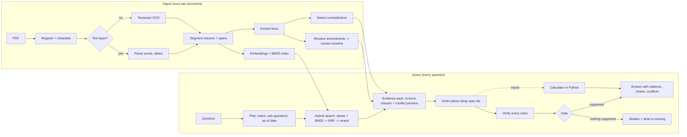

# Verifiable Document AI

Ask questions across several PDFs and get answers **only when they can be proven from the documents**. Every sentence shown
cites the document, the page and the exact quoted wording. When documents disagree, you see both sides. When a rule was
amended, you see which version is in force on a date. When there is no proof, it says so instead of guessing.

Everything runs on **open-source models served by our own service**. There is no OpenAI, Anthropic or Gemini call anywhere.

The demo corpus is fictional (Kestrel Finance Ltd., Financial Conduct Board): a loan agreement, a schedule of charges, two
amendments, a regulator circular and a scanned FAQ.

## What it does

| Capability | How you see it |
|---|---|
| Cited answers | Each statement has numbered citation chips; the side panel shows the real PDF page with the quote highlighted |
| Verification | Every statement passes span, number, quote, version and entailment checks before it is shown ("How we checked" tab) |
| Abstention | "I don't have proof for this in the uploaded documents" plus what was being looked for |
| Contradictions | A "Documents disagree" comparison with both quotes, found at ingest time and re-checked per answer |
| Amendment chains | The rule in force on the as-of date, with the chain original → amendment → amendment |
| Scanned pages | OCR with a "Scanned page" badge on every citation that came from it |
| Calculator | EMI, total late fee, prepayment charge. The working is shown; the maths is done in Python, never by the model |
| Faithfulness score | Share of drafted claims that passed verification, shown on every answer |
| Multiple chats, document library | Per-chat history and as-of date; upload PDFs and watch them go to Ready |

## How it works



**Verification.** The model only *proposes* claims and references span ids. Code then checks each claim:
(a) every cited span exists in the evidence, (b) every number, date and percentage appears in the cited text,
(c) any quoted text matches the source, (d) the cited clause is in force on the as-of date (history questions are exempt),
(e) an entailment model (HHEM) scores support, with a threshold of 0.5 (ADR-014), and (f) the claim is not one side of an
active conflict (those are shown as a disagreement). Quotes shown to you are copied from stored spans, never generated.
Anything that fails goes to "Blocked claims", never into the answer.

**Abstention.** If no claim passes, the answer is "I don't have proof…" with the missing items. Questions about things the
documents do not contain (for example GST on a fee, or credit-card fees in a loan agreement) abstain.

**Amendments and conflicts** are computed once at ingest and stored; a query only looks them up and re-checks the retrieved
clauses. Nothing scans the whole corpus per question.

## Models

| Role | Model | Why |
|---|---|---|
| Planner, fact extraction, drafting, judging | `qwen3.5:4b` via Ollama (temperature 0, JSON-schema output) | Open weights, fits a T4 with room to spare; everything was tuned on it (ADR-012) |
| Embeddings | `BAAI/bge-m3` | Strong multilingual dense retrieval |
| Reranker | `BAAI/bge-reranker-v2-m3` | Cross-encoder over the top candidates |
| Entailment check | `vectara/hallucination_evaluation_model` (HHEM-2.1-open) | Scores whether a claim is supported by its cited text |
| OCR | Tesseract 5 (`eng`, `hin`) | Runs on CPU in the app container |

## Run it locally

```bash
pip install -r requirements.txt -r requirements-service.txt
ollama pull qwen3.5:4b
python -m model_service.local                 # model service on :8080 (uses your running Ollama)
python corpus/generate.py                      # demo PDFs -> corpus/pdfs
python scripts/ingest_corpus.py --reset        # ingest into ./data
cd web && npm install && npm run build && cd ..
uvicorn api.main:app --port 8000               # app + UI on http://localhost:8000
```

Dev loop: `cd web && npm run dev` serves the UI on :5173 and proxies `/api` to :8000.
Tests: `pytest -q`, `cd web && npm test`, and the acceptance eval `python scripts/eval.py` (`--skip-types hindi` until Hindi lands).
Scanned documents need Tesseract (`apt install tesseract-ocr tesseract-ocr-hin`, or `winget install UB-Mannheim.TesseractOCR`).
Environment: `MODEL_BASE_URL`, `MODEL_API_KEY`, `DATA_DIR`, `LLM_MODEL`; see `.claude/docs/runbook.md`.

## Deployment (Modal)

Two Modal apps: the **model service** on a T4 GPU (`model_service/modal_app.py`) and the **app** on CPU
(`deploy/modal_app_ui.py`: FastAPI + built UI + Tesseract, behind a shared access code). They talk over HTTPS with a bearer token kept in Modal secrets.
The app runs as a single container with SQLite on local disk, synced to a Modal Volume. Step by step: `.claude/docs/runbook.md` §3.

## Evaluation

`tests/qa.yaml` holds 40 questions (single, multi-document, tables, current rule, as-of date, conflicts, unanswerable,
calculation, scanned, Hindi). `python scripts/eval.py` scores them with the same code path as the UI and checks the release gates
(unsupported claims displayed = 0, quote exactness, abstention recall, conflict recall, version correctness, retrieval recall,
latency). See `.claude/docs/eval.md`. Latest results are in `.claude/docs/progress.md`.

## Limitations

- **Small model.** A 4B model sometimes lists a spurious "missing" note (status `partial`) or cites a different valid source than expected. Verification stops wrong claims from being shown; it cannot make the model complete.
- **OCR.** English and Hindi packs only; tables on scanned pages are not rebuilt; Tesseract can misread glyphs (a narrow repair handles the rupee sign before lakh/crore). Low confidence is visible through the scanned-page badge.
- **Corpus scale.** Built for a handful of documents, not thousands. Dense vectors are a NumPy array searched exhaustively.
- **Single container.** One writer for SQLite; the app does not scale out. Access is a single shared code with per-visitor and daily limits on questions and uploads (no individual accounts), so treat the public URL as a demo.
- **Hindi** question answering is not implemented yet.
- **Tuned on one corpus.** A held-out set of differently formatted documents is used to check for overfitting (see the evaluation notes).
