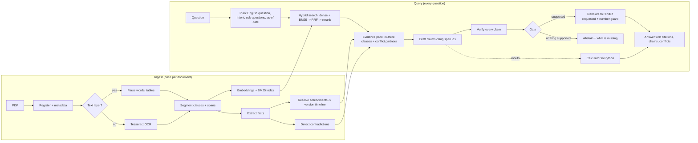

# DocAI: Verifiable Document AI

DocAI answers questions across multiple PDFs and shows an answer **only when it can be proven from the documents**. Every
sentence cites the document, the page and the exact wording from the source. When documents disagree, both sides are shown.
When a rule was amended, the version in force on a chosen date is shown together with its history. When the evidence is
missing, DocAI says so instead of guessing.

All models are open source and run on infrastructure you control. The application makes no calls to OpenAI, Anthropic or
Gemini.

The bundled demo corpus is fictional (Kestrel Finance Ltd., Financial Conduct Board): a loan agreement, a schedule of charges,
two amendments, a regulator circular and a scanned FAQ.

## Features

| Capability | Description |
|---|---|
| Cited answers | Numbered citation chips on every statement. A side panel shows the original PDF page with the quoted wording highlighted. |
| Verification | Each statement passes span, number, quote, version and entailment checks before it is displayed. The "How we checked" tab shows the results. |
| Abstention | When nothing can be proven, the answer is "I don't have proof for this in the uploaded documents" together with what was being looked for. |
| Contradictions | Conflicting clauses are found when a document is ingested and shown side by side, both with their quotes. |
| Amendment chains | The rule in force on the selected date is shown with its chain: original clause, then each amendment. |
| Scanned pages | OCR for image-only pages. Citations that come from OCR carry a "Scanned page" badge. |
| Calculator | EMI, total late fees and prepayment charge. The working is shown, and the arithmetic runs in Python, never in the model. |
| Hindi | Ask in Hindi and receive the answer in Hindi. Quotes stay in the source language and a number guard rejects any translation whose figures differ from the verified answer. |
| Workspaces | Documents and chats are grouped into workspaces. Conflicts, amendments and answers never cross workspace boundaries. |
| Document scope | A chat can be limited to selected documents. |
| Export | Download a chat as Markdown, including citations and quotes. |
| Faithfulness score | The share of drafted statements that passed verification, shown on every answer. |
| Access control | An optional shared access code with per-visitor limits protects a public deployment. |

## How it works



**Verification.** The language model only proposes claims and references span ids. Code then checks every claim:

1. every cited span exists in the evidence;
2. every number, date and percentage appears in the cited text;
3. any quoted text matches the source;
4. the cited clause is in force on the as-of date (history questions are exempt);
5. an entailment model (HHEM) scores support against a threshold of 0.5;
6. the claim is not one side of an active conflict (those are shown as a disagreement).

Quotes shown to the user are copied from stored spans and never generated. A claim that fails any check goes to
"Blocked claims" and is not part of the answer.

**Abstention.** If no claim passes, the answer states that there is no proof and lists the missing items. Questions about
things the documents do not contain, such as GST on a fee, abstain.

**Amendments and conflicts** are computed once at ingest and stored. A query only looks them up and re-checks the retrieved
clauses, so nothing scans the whole corpus per question.

**Hindi.** The pipeline runs in English so that every check applies unchanged. The planner returns an English form of the
question. After verification, the shown claims and missing items are translated in one batched call. Each translation is kept
only if it contains Devanagari text and its numbers equal those of the verified English sentence. The Hindi wording is stored
beside the verified English, never in place of it.

## Models

| Role | Model | Purpose |
|---|---|---|
| Planning, fact extraction, drafting, judging, translation | `qwen3.5:4b` via Ollama (temperature 0, JSON-schema output) | Open weights, runs on a single T4 or on CPU |
| Embeddings | `BAAI/bge-m3` | Multilingual dense retrieval |
| Reranker | `BAAI/bge-reranker-v2-m3` | Cross-encoder over the top candidates |
| Entailment check | `vectara/hallucination_evaluation_model` (HHEM-2.1-open) | Scores whether a claim is supported by its cited text |
| OCR | Tesseract 5 (`eng`, `hin`) | Runs on CPU in the application container |

All model calls go through one model service (`model_service/`) exposing `/llm/chat`, `/embed`, `/rerank` and `/nli`. The
application only needs its base URL.

## Repository layout

```
api/              FastAPI routes: chats (SSE answers), documents, workspaces, conflicts, amendments, export, access control
web/              React + TypeScript + Tailwind UI (Vite)
core/             Ingest, retrieval, answering, verification, versions, conflicts, i18n
model_service/    Model gateway: Ollama LLM plus embedding, rerank and entailment models
corpus/           Generator for the fictional demo PDFs
scripts/          Ingest, evaluation and smoke-test scripts
tests/            Backend tests and the evaluation question set
deploy/           Modal deployment of the application
```

## Getting started

Requirements: Python 3.11, a recent Node.js, [Ollama](https://ollama.com), and Tesseract if you need scanned pages
(`apt install tesseract-ocr tesseract-ocr-hin`, or `winget install UB-Mannheim.TesseractOCR`).

```bash
pip install -r requirements.txt -r requirements-service.txt
ollama pull qwen3.5:4b
cp .env.example .env                           # then set LLM_MODEL=qwen3.5:4b (and AUX_DEVICE=cpu without a GPU)

python -m model_service.local                  # model service on :8080 (uses your running Ollama)
python corpus/generate.py                      # demo PDFs -> corpus/pdfs
python scripts/ingest_corpus.py --reset        # ingest into ./data

cd web && npm install && npm run build && cd ..
uvicorn api.main:app --port 8000               # application and UI on http://localhost:8000
```

The first request downloads the embedding, reranker and entailment models from the Hugging Face Hub (several GB).

Configuration is read from `.env`:

| Variable | Meaning |
|---|---|
| `MODEL_BASE_URL` | Base URL of the model service |
| `MODEL_API_KEY` | Bearer token shared by the application and the model service |
| `LLM_MODEL` | Ollama model tag |
| `AUX_DEVICE` | `cuda` or `cpu` for the embedding, rerank and entailment models |
| `DATA_DIR` | Location of the database, indexes, page images and logs |
| `ACCESS_CODE` | Optional shared access code for the web application |

For frontend development run `cd web && npm run dev`, which serves the UI on port 5173 and proxies `/api` to port 8000.
`.claude/docs/runbook.md` describes the development, Colab and production setups in detail.

## Using the application

1. Create or open a workspace and add PDFs on the **Documents** page. Each document moves from Queued to Ready.
2. Ask a question in the chat. Pick the "rules as of" date to see an earlier or later version of a rule.
3. Click a citation to open the source page with the quoted wording highlighted.
4. Use the **Conflicts** and **Amendments** pages to review every disagreement and every rule history in the workspace.
5. Switch the interface to Hindi with the language button in the sidebar to ask and read answers in Hindi.

Example questions on the demo corpus:

| Question | Result |
|---|---|
| What fees apply if I pay an EMI late? | Three documents disagree: ₹500, ₹750 and a ₹600 cap, shown side by side |
| What is the prepayment charge today for a floating-rate loan? | Nil, with the chain agreement, amendment, amendment |
| The same question with rules as of 1 June 2025 | 3% |
| What is the GST rate on the processing fee? | "I don't have proof", with the missing item |
| What is the EMI on ₹5,00,000 at the agreement rate for 36 months? | ₹16,968, with the working shown |

## Deployment (Modal)

The deployment consists of two Modal apps: the **model service** on a T4 GPU (`model_service/modal_app.py`) and the
**application** on CPU (`deploy/modal_app_ui.py`: FastAPI, the built UI and Tesseract, protected by a shared access code).
They communicate over HTTPS with a bearer token stored in Modal secrets. The application runs as a single container with
SQLite on local disk, synchronised to a Modal Volume. The health check is passive, so an open browser tab does not wake the
GPU; a question does. Step-by-step instructions are in `.claude/docs/runbook.md`, section 3.

## Testing and evaluation

```bash
pytest -q                          # backend tests
cd web && npm test                 # frontend tests
cd web && npm run typecheck        # TypeScript type check
python scripts/eval.py             # acceptance evaluation on tests/qa.yaml
```

`tests/qa.yaml` holds 40 questions covering single-document, multi-document and table lookups, current rule, as-of date,
conflicts, unanswerable questions, calculation, scanned pages and Hindi. `scripts/eval.py` scores them with the same code path as
the UI and checks the release gates: unsupported claims displayed, quote exactness, abstention recall, conflict recall,
version correctness, retrieval recall and latency. Details are in `.claude/docs/eval.md`.

Results of the final deployed run (39 questions, Hindi excluded):

| Measure | Result |
|---|---|
| Questions passed | 37 of 39 |
| Unsupported claims displayed | 0 |
| Quote exactness | 54 of 54 |
| Answerable questions wrongly refused | 0 of 33 |
| Median answer time | 8.3 s on a T4 |

## Documentation

Design documents live in `.claude/docs/`: `spec.md` (requirements), `architecture.md`, `data-model.md`, the `design/` folder
(ingest, retrieval, facts, amendments, contradictions, answering, workspaces, UI), `decisions.md` (architecture decisions),
`eval.md` and `runbook.md`.
